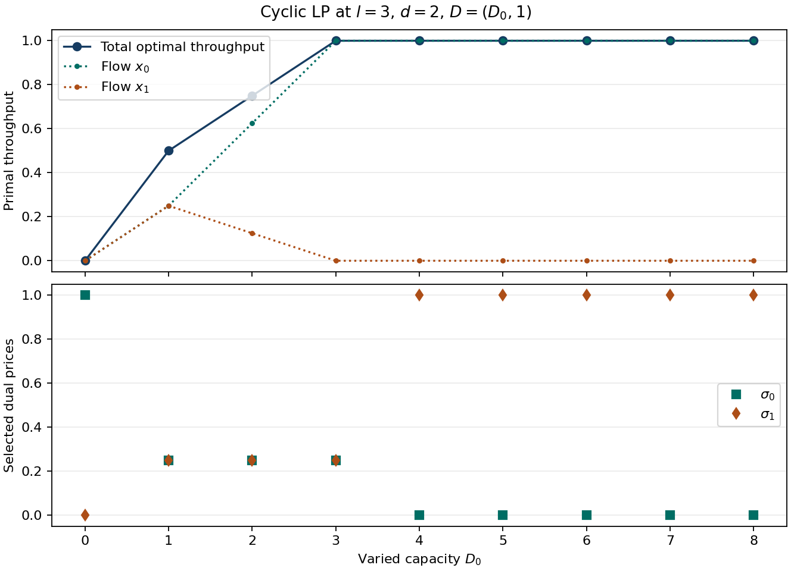

# B2 · Cyclic capacity and dual prices

Fix an integer \(l\ge3\), an even integer \(d\ge2\), and real budgets \(D_s\ge0\) at vertices \(s\in\mathbb Z/d\mathbb Z\). For every odd offset \(0<i<d\), the arc \((s,i)\) goes from \(s\) to \(s+i\). Sending one unit along that arc consumes \(l^i\) units of budget at its source and one at its destination. This is a packing problem with two different coefficients per arc. [Pinned definitions](https://github.com/Deicyde/riemann-hypothesis/blob/a172c464fd4bcfc4f53e394dcba45d742b1409a6/src/Formalism/IncomingBounds/IncomingBound.lean#L12-L38)

## The two optimization problems

With sums over the odd offsets, the primal maximizes throughput
\[
P(x)=\sum_{s,i}x_{s,i}, \qquad
x_{s,i}\ge0,\qquad \sum_i(l^ix_{s,i}+x_{s-i,i})\le D_s .
\]
The dual assigns a price \(\sigma_s\) to one unit of vertex budget. It minimizes
\[
Q(\sigma)=\sum_sD_s\sigma_s, \qquad
0\le\sigma_s\le1,\qquad l^i\sigma_s+\sigma_{s+i}\ge1 .
\]
Each covering inequality prices the two resources used by one arc at a combined cost of at least one. For feasible \(x,\sigma\),
\[
P(x)\le\sum_{s,i}(l^i\sigma_s+\sigma_{s+i})x_{s,i}
=\sum_s \sigma_s\sum_i(l^ix_{s,i}+x_{s-i,i})
\le Q(\sigma).
\]
This is weak duality. Equality gives a certificate that **both** feasible vectors are optimal.

## Exact content of the universal theorems

For every \(l,d,D\) as above, \(\mathrm{FlowAttained}\) asserts a feasible \(x\) whose throughput equals the supremum \(M=\sup P(x)\). The finite feasible projection is nonempty because it contains zero. It is closed and bounded since \(0\le x_{s,i}\le D_s/l^i\). Hence the supremum is attained in that projection. Lean's function type also allows offsets outside the finite arc set, where assigning zero extends a finite vector to a feasible function.

Put \(\gamma=l/(l^2-1)\) and \(F=\gamma\sum_s D_s-M\). The second proposition, \(\mathrm{LemmaFa}\), says
\[
\begin{aligned}
&\exists \sigma\;\bigl[
  \sigma\text{ is dual feasible}\ \land\
  (\forall s,\ \forall\text{ positive odd }i,\quad l^i\sigma_s+\sigma_{s+i}\ge1)
  \ \land\ F=\textstyle\sum_sD_s(\gamma-\sigma_s)
\bigr],\\
&F=\max\{\textstyle\sum_sD_s(\gamma-\tau_s):\tau\text{ is dual feasible}\}.
\end{aligned}
\]
The source expresses the second clause with an attained greatest value. Ordinary finite LP strong duality gives \(\min Q=M\). Clipping dual coordinates above one to one preserves the covering constraints, because every coefficient on a participating coordinate is at least one. It can only lower the dual cost. For an arbitrary positive odd \(i\), reducing modulo even \(d\) gives a positive odd representative \(r<d\) with the same destination and \(l^i\ge l^r\). Thus the finite constraints imply the extended ones. The exact Lean types have an additional \(\mathrm{NeZero}(d)\) instance parameter, which the stated lower bound on \(d\) supplies mathematically. [Proposition statements](https://github.com/Deicyde/riemann-hypothesis/blob/a172c464fd4bcfc4f53e394dcba45d742b1409a6/src/Formalism/IncomingBounds/IncomingBound.lean#L52-L61) · [Proof declarations](https://github.com/Deicyde/riemann-hypothesis/blob/a172c464fd4bcfc4f53e394dcba45d742b1409a6/src/Formalism/IncomingBounds/FlowDegreeBounds/MaxFlowValueAttained.lean#L423-L449)

## Exact finite examples

- For \(l=3,d=2,D=(1,1)\), each flow and price equals \(1/4\). The two loads and covering left sides are one. Both objectives are \(1/2\).
- For \(l=3,d=6,D=(243,0,0,0,0,1)\), sending one unit along offset five from vertex zero is optimal. Restricting to offset one would leave only the reverse arc from vertex five to zero with throughput at most \(1/3\). Odd offsets greater than one can genuinely matter even though their price constraints follow from some shorter constraints in special cases.
- For \(l=7,d=2,D=(2^{53}+1,2^{53}-1)\), the sum objective is \(2^{51}\), while the two primal coordinates differ by \(1/3\). An IEEE binary64 input cannot represent \(2^{53}+1\) exactly. Oct uses integer pivots here and Go rechecks the fractions without a tolerance. [Replayable certificates](../artifacts/b2/certificates.json)

In the plot, \(D=(a,1)\). When \(1/3<a<3\) both capacity constraints bind. The dual prices are then both \(1/4\), and throughput is \((a+1)/4\). At \(a>3\), the second budget alone limits throughput. The selected dual price of the first vertex falls to zero. The discrete markers show one chosen optimum at each sampled budget, where other prices can be optimal at a breakpoint.

The general two theorems cover arbitrary even lengths and real budgets. The Go and Oct experiment covers 435 finite instances at lengths two, four and six. This is established LP mathematics. The useful result is a portable workflow that can expose when a long arc matters, certify an individual solution, and separately replay the universal proof. [Verification and commands](b2-verification.md)
