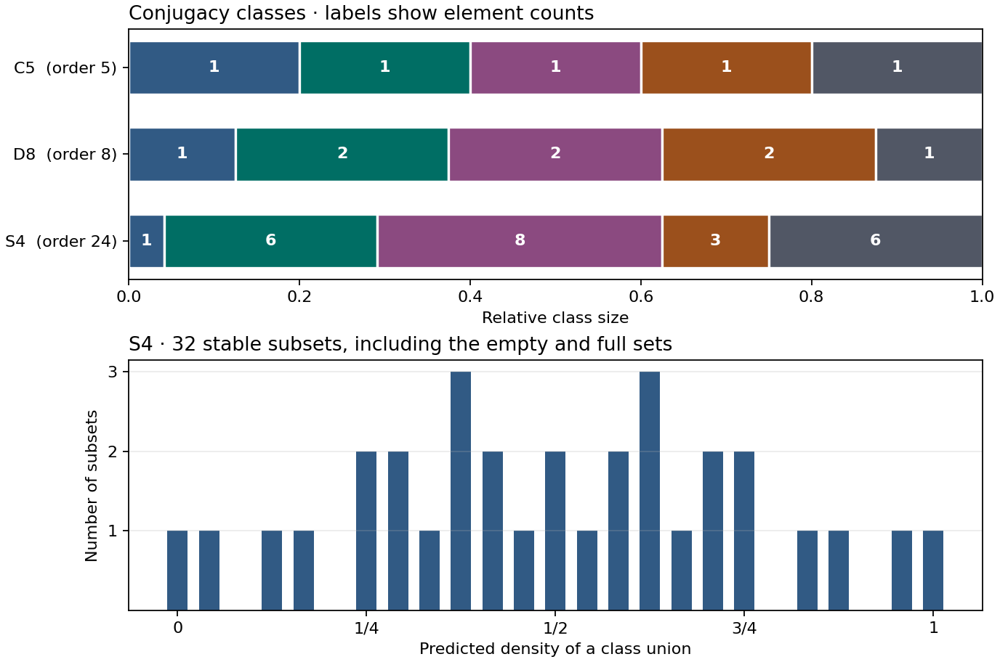

# B3 · Chebotarev for conjugacy-stable sets

## Three layers

| Layer | Exact mathematical claim | B3 evidence |
|---|---|---|
| A · Finite groups | A conjugacy-stable subset \(C\subseteq G\) is the disjoint union of its conjugacy classes. Its weight is \(|C|/|G|\). For the class of \(\sigma\), this equals \(1/|Z_G(\sigma)|\). | Lean class and counting arguments, and independent Oct–Go checks of 96 finite subsets. |
| B · One Frobenius class | For every \(\sigma\) in the Galois group of a Galois extension of number fields, the unramified base primes with Frobenius conjugate to \(\sigma\) have Dirichlet density \(1/|Z_G(\sigma)|\). | Source traced. B3 replayed two analytic prerequisites in the degree-one branch. The original single-class proof was outside the completed build. |
| C · All stable sets | For every such extension and every conjugacy-stable \(C\), the corresponding prime set has Dirichlet density \(|C|/|G|\). | B3's independently authored conditional implication passed Lean and the kernel replay. It explicitly takes layer B as a premise. |

## The source statements

Write \(P(K)\) for the height-one prime ideals of the ring of integers of \(K\). For \(S\subseteq P(K)\) and real \(s>1\), set \(P_S(s)=\sum_{\mathfrak p\in S}N(\mathfrak p)^{-s}\). The density predicate is the right-hand limit of \(P_S(s)/P_{P(K)}(s)\) at \(s=1\). B3 uses the very same Mathlib `NumberField.Set.HasDirichletDensity` definition as the corpus, including its totalized infinite sums and division. It makes a Dirichlet-density assertion. [Pinned Mathlib definition](https://github.com/leanprover-community/mathlib4/blob/0df444a360eaa60ab8c11dca51a86af692955474/Mathlib/NumberTheory/NumberField/DirichletDensity.lean)

In the original, \(K,L\) are number fields with an algebra structure and \(\operatorname{IsGalois}(L/K)\). Write \(G=\operatorname{Gal}(L/K)\). The set \(\mathrm{Cheb}(C)\) consists of primes \(v\in P(K)\) such that **every** \(w\in P(L)\) above \(v\) has \(e(w/v)=1\) and arithmetic Frobenius in \(C\). For \(\sigma\in G\), let \(E=L^{\langle\sigma\rangle}\). The Deuring set \(A_\sigma\subseteq P(E)\) consists of primes \(u\) of relative residue degree one over \(K\) such that every \(w\) over \(u\) is unramified over \(K\) and has Frobenius \(\sigma\), viewed in \(\operatorname{Gal}(L/E)\). [Pinned definitions at lines 17 and 60](https://github.com/Deicyde/riemann-hypothesis/blob/a172c464fd4bcfc4f53e394dcba45d742b1409a6/src/GroundTheory/GlobalFields/TateThesis/ChebotarevCount.lean#L17)

- **`HasDirichletDensity.union`, line 55.** For any two disjoint subsets of \(P(K)\) with densities \(a,b\), their union has density \(a+b\).
- **`hasDirichletDensity_deuringSet`, line 92.** For every \(\sigma\), \(A_\sigma\) has density \(1/\operatorname{ord}(\sigma)\), as a subset of \(P(E)\).
- **`hasDirichletDensity_chebotarevSet_isConj`, line 114.** For every \(\sigma\), \(\mathrm{Cheb}(\{t:\sigma\sim t\})\) has density \(1/|Z_G(\sigma)|\).
- **`hasDirichletDensity_chebotarevSet`, line 198.** For every \(C\subseteq G\) satisfying \(\tau\sigma\tau^{-1}\in C\) for all \(\sigma\in C,\tau\in G\), \(\mathrm{Cheb}(C)\) has density \(|C|/|G|\).

The exact Lean headers, source SHA-256 values and direct import graph are in the closure manifest. The B1 typed statement record was independently extracted again and retains its source-review status. [Pinned theorem file](https://github.com/Deicyde/riemann-hypothesis/blob/a172c464fd4bcfc4f53e394dcba45d742b1409a6/src/GroundTheory/GlobalFields/TateThesis/Chebotarev.lean#L55) · [Closure and headers](../artifacts/b3/imports.json) · [Go source record](../artifacts/b3/source-statement.json)

## The independent finite-union proof

The proof indexes primes by a tag in the quotient `ConjClasses G` and a separate set of good primes. Fibres over distinct tags are disjoint. A finite induction adds one fibre at a time and applies the analogous disjoint decomposition to elements of \(G\). The relative sizes therefore add to \(|C|/|G|\). A subset stable under `IsConj` equals the preimage of its image in the quotient. For a group, that condition is equivalent to stability under \(\tau\sigma\tau^{-1}\).

The version closest to the original takes a place-above relation, an unramified predicate and a Frobenius map. It assumes a place exists above every base prime and that Frobenius values of two places above one prime are conjugate. The tagged-prime predicate then agrees with the original every-place predicate for stable \(C\). This separates the algebraic inputs from the single-class analytic hypothesis. The argument uses the exact number-field density ratio, and does not link the custom arithmetic Frobenius definition from the corpus into the Mathlib-only module. In the source, `nonempty_placesOver` and `isConj_arithFrobAt_of_liesOver` justify the two structural inputs. [Standalone proof and exact types](../scripts/B3.lean) · [Source place comparison](https://github.com/Deicyde/riemann-hypothesis/blob/a172c464fd4bcfc4f53e394dcba45d742b1409a6/src/GroundTheory/GlobalFields/TateThesis/Chebotarev.lean#L164)

Disjoint additivity also has a small standalone proof at the level of the ratio. When the all-prime sum is summable, restriction to either subset is summable and the numerator splits. When the all-prime sum is not summable, Mathlib assigns the denominator the value zero and all three ratios are zero. This avoids a separate convergence premise for the **additivity** lemma. It supplies no density for any individual class.

## Where the original single-class result spends its analytic input

1. **Abelian density.** \(L/E\) is cyclic with generator induced by \(\sigma\). `GroundTheory.Global.hasDirichletDensity_setOf_arithFrobAt_eq` in `ChebotarevAbelian.lean` supplies density \(1/\operatorname{ord}(\sigma)\) there. It invokes ray-class/idele-symbol equidistribution together with a surjective reciprocity map and a Frobenius compatibility law.
2. **Residue degree and ramification.** Intersecting with the relative degree-one primes preserves the density. Removing the finitely many primes ramified over \(K\) gives the actual \(A_\sigma\). The source uses tower multiplicativity of ramification indices and a bounded-prime-sum comparison.
3. **Count and norm.** Over each \(v\in\mathrm{Cheb}([\sigma])\), the Deuring fibre has size \(n=|Z_G(\sigma)|/\operatorname{ord}(\sigma)\). The source counts places using the Galois action and Frobenius conjugacy. Relative residue degree one gives \(N(u)=N(v)\), so \(P_{A_\sigma}(s)=nP_{\mathrm{Cheb}([\sigma])}(s)\) for \(s>1\).
4. **Change of base.** The ratio of the all-prime sums for \(E\) and \(K\) tends to one. Thus the single-class density downstairs is \((1/\operatorname{ord}(\sigma))/n=1/|Z_G(\sigma)|\). The original union then removes one class at a time. Orbit-stabilizer converts reciprocal centralizer size to relative class size.

The smallest remaining analytic interface on this route is the **abelian specified-Frobenius density over \(E\)**. B3's completed degree-one replay independently verifies the two comparisons in steps 2 and 4. The uncompleted original attempt also leaves the custom fibre count and Frobenius laws unverified here. [Abelian supplier](https://github.com/Deicyde/riemann-hypothesis/blob/a172c464fd4bcfc4f53e394dcba45d742b1409a6/src/GroundTheory/GlobalFields/TateThesis/ChebotarevAbelian.lean#L90) · [Fibre identity](https://github.com/Deicyde/riemann-hypothesis/blob/a172c464fd4bcfc4f53e394dcba45d742b1409a6/src/GroundTheory/GlobalFields/TateThesis/ChebotarevCount.lean#L142) · [Single-class proof](https://github.com/Deicyde/riemann-hypothesis/blob/a172c464fd4bcfc4f53e394dcba45d742b1409a6/src/GroundTheory/GlobalFields/TateThesis/Chebotarev.lean#L114)

At the B1 pin `c64095e6cc6483b401849c7fd9182d983d3bf261`, CBirkbeck's theorem is indexed directly by a quotient conjugacy class, uses ideals and a Frobenius-class function, and has a `sorry` in the single-class proof. The B3 implication could use that class-shaped result once available, after identifying the prime-set and density APIs. The corpus states a union-of-classes result, which is stronger as a direct interface and follows from single-class density by finite additivity. This comparison does not settle priority. [Pinned external statement](https://github.com/CBirkbeck/chebotarev-density/blob/c64095e6cc6483b401849c7fd9182d983d3bf261/CebotarevDensity/Main.lean#L24)

## Finite exploration

Oct exported multiplication and inverse tables, classes and all stable subsets for \(C_5\), the order-eight dihedral group \(D_8\), and \(S_4\). Each has five classes, giving 32 stable subsets per group. The multiset of class sizes for \(S_4\) is \(1,3,6,6,8\), so weight \(3/8\) occurs in three ways: the identity plus the 3-cycles, or the double transpositions plus one of the two classes of size six. The corresponding complements each have weight \(5/8\). These are predicted weights from the group alone. [Exact certificates](../artifacts/b3/certificates.json)

[Verification, failure evidence and replay](b3-verification.md)
